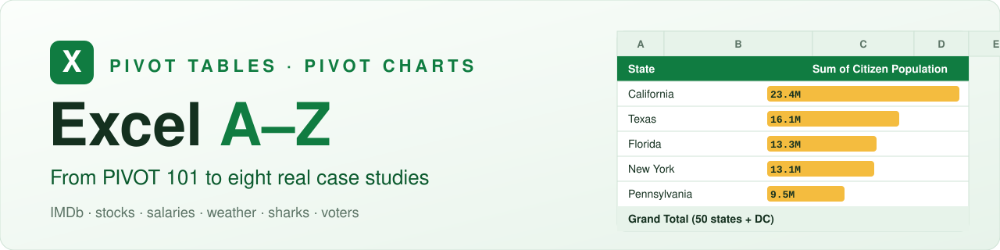
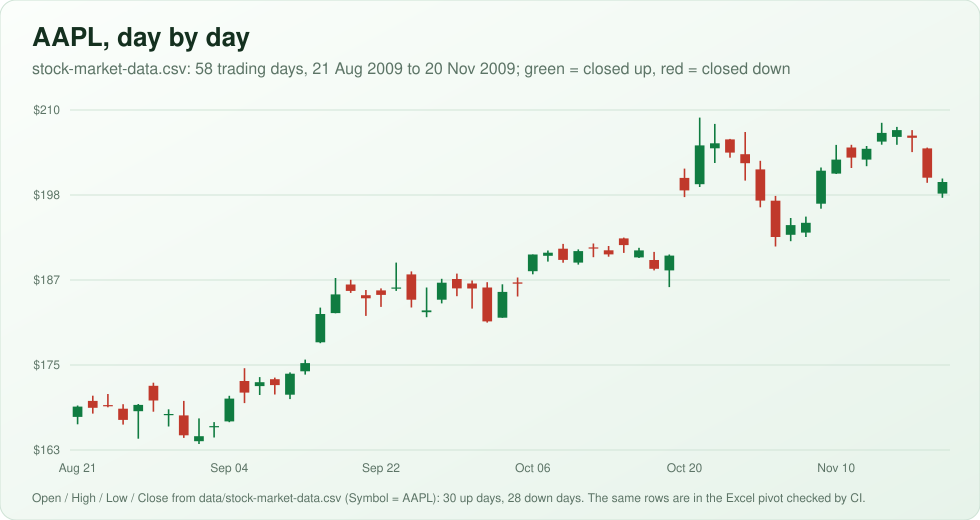
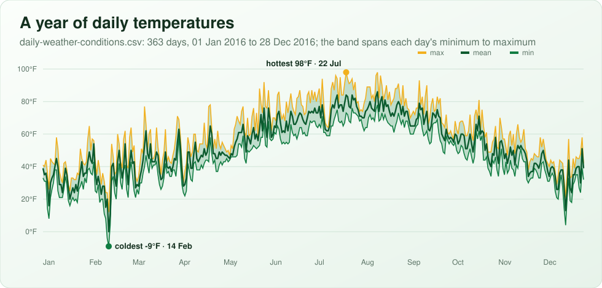
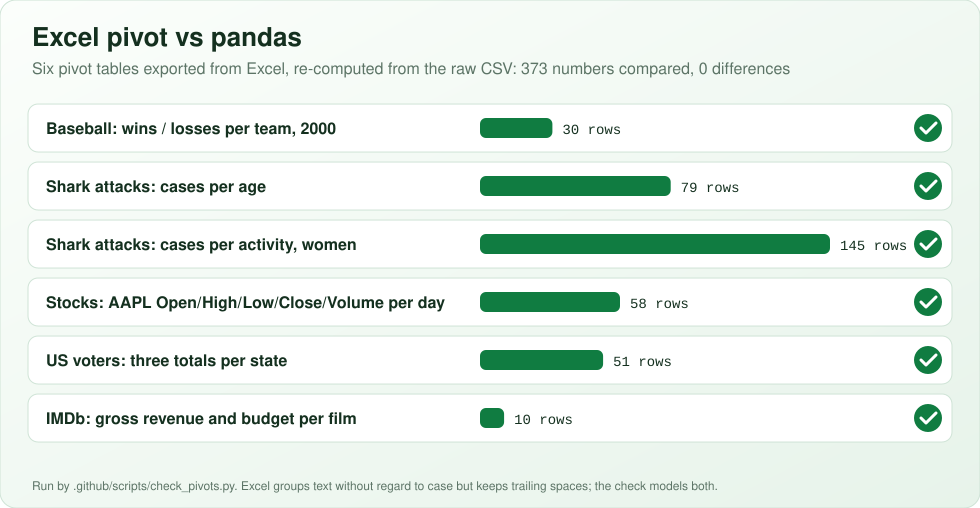

<p align="center">
  
  
  
  
  <a href=".github/workflows/pivots-run.yml"></a>
  
</p>

A hands-on workbook for **Excel pivot tables and pivot charts**: two guides, the IMDb movie database, and eight real case studies, from Facebook posts to shark attacks. The repository keeps the data, the pivot tables exported from Excel as PDFs and CSVs, and a script that **checks the exported numbers** by re-computing them with pandas.

> *"6 Excel pivot tables, 373 numbers, re-computed from the raw data: 0 differences."*

---

## Course map

| # | Section | What is inside | Files |
|:-:|---------|----------------|:-----:|
| 00 | [Quickstart](00-quickstart/) 🎯 | The same three rows as CSV and as a real workbook | 2 |
| 01 | [Basics](01-basics/) 📘 | PIVOT TABLE 101 and the case-study overview (PDF) | 2 |
| 02 | [Pivot Tables](02-pivot-tables/) 🧮 | Revenue and budget by genre on the IMDb database | 3 |
| 03 | [Pivot Charts](03-pivot-charts/) 📊 | Charts built on those pivot tables | 3 |
| 04 | [Case Studies](04-case-studies/) 🧪 | Eight datasets, one question each | 17 |
| – | [Data](data/) 📂 | The nine raw CSV files, stored with Git LFS | 9 |

---

## Case studies

| # | Case study | Raw data | Question |
|:-:|------------|:--------:|----------|
| 01 | [Spartan Race Facebook Posts](04-case-studies/01-spartan-race-facebook-posts/) | 393 rows | Which hour of the day gets the most posts, and which post type earns the most shares, reactions, likes and comments? |
| 02 | [Daily Weather Conditions](04-case-studies/02-daily-weather-conditions/) | 363 rows | Average maximum temperature per day, and max / min temperature and wind speed per date. |
| 03 | [San Diego Burrito Ratings](04-case-studies/03-san-diego-burrito-ratings/) | 237 rows | Average tortilla, filling, temperature and synergy scores per burrito type. |
| 04 | [Baseball Team Stats](04-case-studies/04-baseball-team-stats/) | 624 rows | Wins and losses per year, and per division and team for a chosen season. |
| 05 | [Stock Market Data](04-case-studies/05-stock-market-data/) | 29,440 rows | Daily open, high, low, close and volume per symbol (AAPL, AMZN), with percent change. |
| 06 | [Shark Attack Records](04-case-studies/06-shark-attack-records/) | 5,292 rows | Cases per activity and per victim age, with the share of the total. |
| 07 | [SF Salaries](04-case-studies/07-sf-salaries/) | 24,285 rows | Average base pay and total overtime and other pay per job title and per employee. |
| 08 | [U.S. Voter Pivot](04-case-studies/08-us-voter-pivot/) | 255 rows | Citizen population, registered and confirmed voters per state and age group. |

Details, file lists and page counts are in [`04-case-studies/`](04-case-studies/).

---

## What the data says

### Stocks: 58 days of AAPL



The Stock Market case study pivots open, high, low, close and volume per day. Drawn as candles, the autumn of 2009 is a steady climb with a gap up in late October.

### Weather: one year in a band



The weather case study averages and sums temperatures per date. Here the whole year is one picture: the hottest day was 98°F on 22 July, the coldest -9°F on 14 February.

### Can you trust a pivot table?



Every pivot above was built by hand in Excel. The manual CI run rebuilds them from the raw CSV with pandas and compares every number: **373 numbers, 0 differences**. Along the way it confirmed two Excel behaviours worth knowing: a pivot table **groups text without regard to case** (`Boogie boarding` and `Boogie Boarding` become one row) but **keeps trailing spaces** (`Body surfing` and `Body surfing ` stay two rows).

---

## Repository layout

```
EXCEL-A-Z/
├── 00-quickstart/          # hello.csv + hello.xlsx
├── 01-basics/              # 2 PDF guides
├── 02-pivot-tables/        # IMDb pivot tables (PDF + CSV)
├── 03-pivot-charts/        # IMDb pivot charts (PDF)
├── 04-case-studies/
│   ├── 01-spartan-race-facebook-posts/
│   ├── ...
│   └── 08-us-voter-pivot/  # PDFs and CSV exports of the pivot tables
├── data/                   # the 9 raw CSV files (Git LFS)
├── assets/                 # README banner and charts
└── .github/                # CI
```

**Why numbered folders?** The course used to live in 12 branches and later in an `archive/` folder. Now it is a plain folder tree on `main`, in the order you would study it; the history of all those steps is kept in the commit graph.

---

## How to use

**Option 1: in the browser.** Open any file and click *Download raw* (Git LFS files download as the real data) or *Open in Excel*.

**Option 2: clone.** The CSV and XLSX files are stored with [Git LFS](https://git-lfs.com), so install it once:

```bash
git lfs install
git clone https://github.com/evgeniimatveev/EXCEL-A-Z.git
cd EXCEL-A-Z
```

Then open the CSV files in Excel (File → Open, or *Data → From Text/CSV*) and build the pivot tables yourself: Insert → PivotTable. Compare your result with the exported pivot in the case study folder.

**Re-compute the pivots in Python:**

```bash
uv run --no-project --with pandas python .github/scripts/check_pivots.py
```

---

## Continuous integration

| Workflow | When | What it does |
|----------|------|--------------|
| [`files-check.yml`](.github/workflows/files-check.yml) | every push and pull request | Checks file names, `.gitattributes` rules, Git LFS pointers, that every PDF opens, and that README links work. Does not download LFS data |
| [`pivots-run.yml`](.github/workflows/pivots-run.yml) | **manual**: Actions → *Pivot tables re-computed (manual)* → *Run workflow* | Downloads the LFS data, checks that the CSV, XLSX and PDF files really open, and re-computes 6 pivot tables with pandas against the Excel exports |

Last full run: **6 of 6 pivot tables reproduced exactly.**

---

## Known limitations

- **Only 6 pivots are machine-checked.** They cover 5 datasets (baseball, shark attacks twice, stocks, U.S. voters, IMDb). The Spartan Race, weather, burrito and SF salaries case studies have only PDF exports, which cannot be compared automatically.
- **The Excel workbooks are not in the repo.** Only the exports (PDF and CSV) are; open the raw CSV in Excel and rebuild the pivot to practise.
- **Two datasets are Windows-1252, not UTF-8** (`shark-attack-records.csv`, `spartan-race-facebook-posts.csv`); `sf-salaries.csv` has four empty trailing columns.
- **Case-study PDFs keep their original export number** (`pivot-06.pdf` was `Pivot Table Case Studies (6).pdf`); the gaps in the numbering are in the originals.
- **`hello.xlsx` was repaired:** it used to be a Markdown table saved under an `.xlsx` name, which Excel cannot open. It is now a real workbook with the same rows.

---

## Tech stack

`Microsoft Excel` · `Pivot Tables` · `Pivot Charts` · `CSV / XLSX / PDF` · `Git LFS` · `pandas` · `GitHub Actions`

---

*Built by [Evgenii Matveev](https://github.com/evgeniimatveev) · Data Analyst / Analytics & MLOps Engineer*
